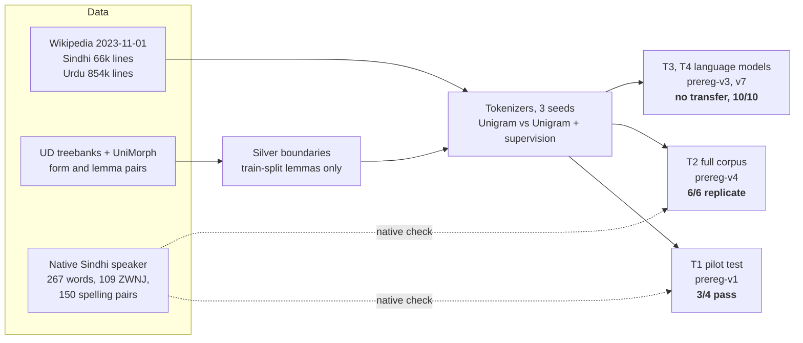
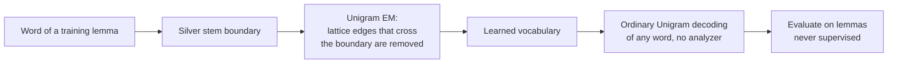
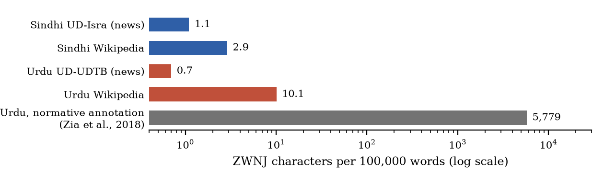
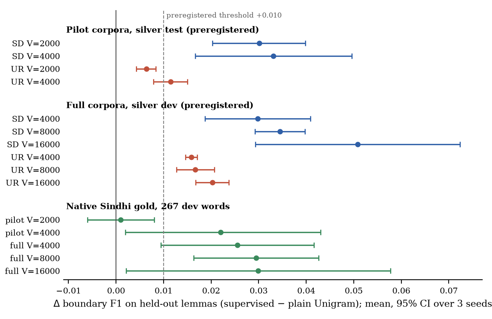
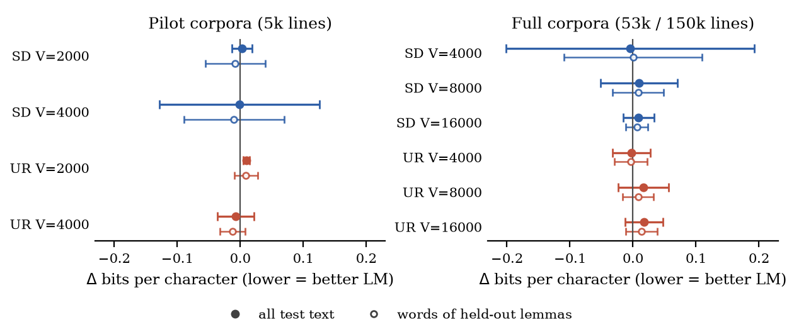
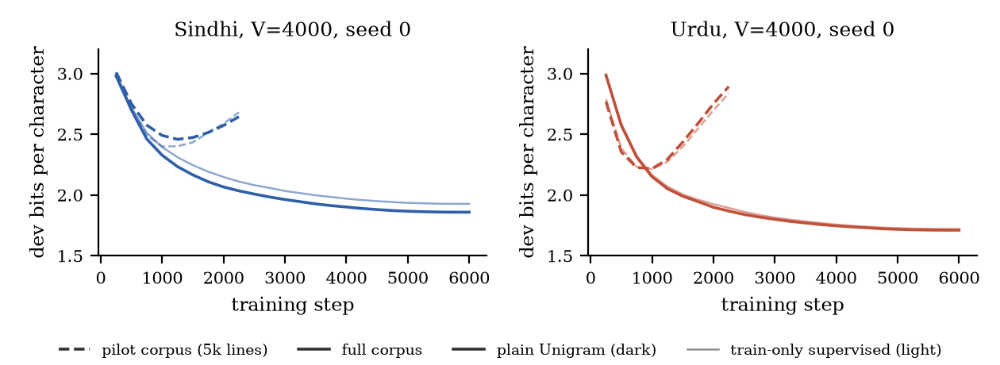
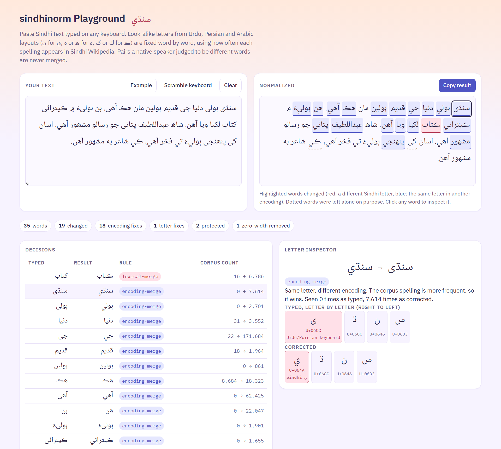

# MorphoTok-SD-UR

**Does morphology-aware tokenization help Sindhi and Urdu? A preregistered answer, and a spelling normalizer for Sindhi.**

[](https://pypi.org/project/sindhinorm/)
[](LICENSE)
[](https://doi.org/10.5281/zenodo.24093293)
[](https://arsalankaleem.me/MorphoTok-SD-UR/)


Subword tokenizers learn their pieces from frequency, so in morphologically rich languages they often cut words away from their morpheme boundaries. This repository tests, under a frozen preregistration, whether giving a tokenizer morphological supervision helps **Sindhi** and **Urdu**, two Arabic-script languages of South Asia. It contains the code, every configuration, the full preregistration history, and the result files behind each number below. It is also the home of **[`sindhinorm`](#sindhinorm-a-spelling-normalizer-for-sindhi)**, a spelling normalizer built on what the study found.

## Results at a glance

| Question | Answer | Evidence |
|---|---|---|
| Does boundary supervision during training improve the segmentation of words the supervision never saw? | **Yes.** 3 of 4 preregistered tests on small corpora; **6 of 6** on full Wikipedia (Sindhi +0.030 to +0.051 boundary F1, Urdu +0.016 to +0.020), at 1 to 5% more tokens per word | [`results/final_test`](results/final_test/decision.md), [`docs/findings_scale.md`](docs/findings_scale.md) |
| Does it hold against native-speaker labels? | **Yes** for Sindhi on full corpora (+0.026 to +0.030 F1 on 267 hand-segmented words). The automatic training labels are only about 55% precise | [`docs/findings_human_review.md`](docs/findings_human_review.md) |
| Does the better segmentation give a better language model? | **No.** 10 preregistered settings, 72 transformer LMs, no detectable improvement in any of them | [`docs/findings_lm.md`](docs/findings_lm.md) |
| Is the zero-width non-joiner (ZWNJ) a useful morphological signal? | **No.** It occurs 0.7 to 10 times per 100,000 words of real text; keyboard look-alike letters are far more common | [`docs/findings_pilot.md`](docs/findings_pilot.md) |
| Can those look-alike letters be fixed safely? | **Yes, per word.** `sindhinorm` restores 94% of keyboard-substituted words and changes about 1.4% of clean words | [`docs/sdnorm.md`](docs/sdnorm.md) |

The method itself is not new: soft supervision is posterior regularization with a fixed dual ([Ganchev et al., 2010](https://jmlr.org/papers/v11/ganchev10a.html)) and its hard form is morphological pre-segmentation. The contribution is the empirical answer, with the negative result tested under the same rules as the positive one.

## Contents

- [Study design](#study-design)
- [Findings](#findings)
- [sindhinorm: a spelling normalizer for Sindhi](#sindhinorm-a-spelling-normalizer-for-sindhi)
- [Preregistration](#preregistration)
- [Reproducing the results](#reproducing-the-results)
- [Repository layout](#repository-layout)
- [Data and licences](#data-and-licences)
- [Limitations](#limitations)
- [Citation](#citation)

## Study design



**Train-only supervision.** Silver boundaries come from manually annotated form and lemma pairs (UD Sindhi-Isra; UD Urdu-UDTB plus UniMorph). They are applied only to words of training-split lemmas, and only while the Unigram vocabulary is being learned. At inference the tokenizer is an ordinary Unigram model: it needs no analyzer and never sees constraints for test words. Any gain on held-out lemmas therefore comes from the vocabulary the supervision induced.



The lattice equations, the soft-to-hard limit and the exact training procedure are in [`docs/lattice.md`](docs/lattice.md).

## Findings

### 1. ZWNJ is rare in practice; look-alike letters are not



Real text almost never contains ZWNJ, while normatively annotated Urdu uses it about 58 times per 1,000 words. Three ZWNJ policies changed tokens per word by at most 0.001. In the 109 Sindhi occurrences, a native speaker found that most are quoted Persian or stray characters. Where ZWNJ does sit inside a Sindhi word it marks a compound or an Arabic *al-* name join (13 of 17). Keyboard look-alike letters are far more frequent: in Urdu Wikipedia, off-standard yeh, kaf and heh code points occur about 25 times as often as ZWNJ.

### 2. Supervision improves segmentation of unseen lemmas, and the gain replicates



| Test | Sindhi | Urdu |
|---|---|---|
| T1, pilot corpora, silver test (V = 2000 / 4000) | +0.030 / +0.033, pass / pass | +0.006 / +0.012, fail (below +0.010) / pass |
| T2, full corpora, silver dev (V = 4000 / 8000 / 16000) | +0.030 / +0.035 / +0.051, all pass | +0.016 / +0.017 / +0.020, all pass |
| Native Sindhi words, full-corpus tokenizers | +0.026 / +0.030 / +0.030, intervals exclude 0 | not reviewed |

A random-boundary control with the same fertility does not reproduce the gain, the hard constraint beats the soft prior, and BPE segments held-out lemmas worse than Unigram in all four T1 cells. Details: [`results/final_test/decision.md`](results/final_test/decision.md), [`results/scale_full/`](results/scale_full/), [`results/human_gold/`](results/human_gold/).

### 3. The gain does not reach language modelling



Small decoder-only transformers (3.7M to 7.3M parameters, Kaggle T4) were trained on the output of each tokenizer and scored in bits per character, which is comparable across tokenizers. On the pilot corpora the supervised tokenizer never helped and was slightly worse in one cell (Urdu V = 2000, +0.45%). Those models overfit early, so the study was repeated on the full corpora:



With enough text the models no longer overfit and test bpc falls by about half a bit, yet the result is the same: **no detectable effect in all 6 cells**, including on words of held-out lemmas. Across both studies the supervised tokenizer never gave a better language model in any of 10 preregistered settings. Tables and provenance: [`docs/findings_lm.md`](docs/findings_lm.md).

### 4. Part-of-speech tagging (exploratory)

With taggers trained from scratch, character input is what makes them robust to spelling changes, and the tokenizer's morphology adds accuracy on unseen lemmas only together with character features (Sindhi: +0.020, +0.011 and +0.026 at 1%, 10% and 100% of the data). With a pretrained encoder (XLM-R) the unseen-lemma benefit disappears while the robustness benefit remains. These runs used the UD test sets during development, so they are reported as exploratory: [`docs/findings_pos.md`](docs/findings_pos.md).

## sindhinorm: a spelling normalizer for Sindhi

Sindhi text is often typed on Urdu, Persian or Arabic keyboards, so identical-looking letters are different characters: ی for ي, ہ or ھ for ه, ک or ك for ڪ. A fixed character map cannot fix this, because ک and ڪ are both Sindhi letters (کي "to" and ڪي "some" are different words). `sindhinorm` decides per word, using spelling frequencies from Sindhi Wikipedia, and never merges a pair that a native speaker judged to be different words.

**[Try it in your browser](https://arsalankaleem.me/MorphoTok-SD-UR/)**: paste text, see which words change and why, and inspect every letter's code point.

<a href="https://arsalankaleem.me/MorphoTok-SD-UR/"></a>

```bash
pip install sindhinorm
```

```python
from sindhinorm import normalize, explain

normalize("هي ڪتاب آهی")  # 'هي ڪتاب آهي' (Farsi yeh fixed)
normalize("ڪي کي")  # 'ڪي کي' (two different words, left alone)
explain("ھن آهی کري")  # the rule and corpus counts behind each decision
```

```bash
sindhinorm < input.txt > output.txt
sindhinorm explain "ھن آهی کري"
```

| Test | Result |
|---|---|
| UD Sindhi test, every ي typed as ی | **94.0%** of 4,511 altered words restored |
| Same words, one random letter changed (control) | 0.4% restored (it does not guess at typos) |
| Clean words changed | 1.35% (bundled word list) |
| 150 native-judged pairs, frequency rule alone | merge precision 0.874, recall 0.992; the 24 different-word pairs are protected explicitly |

Source, browser version and release guide: [`packages/sindhinorm/`](packages/sindhinorm/). Evaluation details and limits: [`docs/sdnorm.md`](docs/sdnorm.md).

## Preregistration

Hypotheses, data, systems, metrics and decision rules were committed and frozen in a git tag before each test. Every later change to the preregistration files is an amendment that states what changed, why, and whether test results had been seen.

| Tag | What it froze or recorded |
|---|---|
| `prereg-v1` | thresholds and the four primary tokenizer tests (T1) |
| `prereg-v2` | Amendment 1: T1 outcome recorded |
| `prereg-v3` | Amendment 2: pilot language-model study (T3) |
| `prereg-v4` | Amendment 3: full-corpus tokenizer replication (T2) |
| `prereg-v5` | Amendment 4: T3 outcome recorded |
| `prereg-v6` | Amendment 5: T2 outcome recorded |
| `prereg-v7` | Amendment 6: full-corpus language-model study (T4) |
| `prereg-v8` | Amendment 7: T4 outcome recorded |

Start with [`prereg/PREREG.md`](prereg/PREREG.md), [`prereg/AMENDMENTS.md`](prereg/AMENDMENTS.md) and the [`prereg/claim_ledger.md`](prereg/claim_ledger.md), which lists every claim with its evidence and status. `python scripts/prereg_freeze.py status` checks a freeze rather than assuming it.

## Reproducing the results

```bash
make setup          # venv with pinned dependencies (Python 3.11), editable installs
make lint test      # ruff + pytest
```

Without `make` (for example on Windows), run the same steps from the `Makefile` or call `python scripts/make_targets.py <target>`.

1. **Data.** Download the files listed with URLs and SHA-256 hashes in [`data/raw/SOURCE.md`](data/raw/SOURCE.md), then run `make real-data`. Corpora and derived files are not committed (licences and size).
2. **Tokenizers and intrinsic tests.** `make tokenizer`, `make intrinsic` and `make ablations` (pilot); `scripts/04_intrinsic_eval.py --split test --final` (T1, refuses to run unless the preregistration is frozen); `scripts/16_scale_eval.py` (T2).
3. **Language models.** `scripts/14_export_lm_data.py` writes token streams; `scripts/lm_gate5.py` trains and scores the models (one GPU; step-by-step Kaggle guides in [`docs/kaggle_lm_tutorial.md`](docs/kaggle_lm_tutorial.md) and [`docs/kaggle_lm_full_tutorial.md`](docs/kaggle_lm_full_tutorial.md)); `scripts/15_lm_report.py` applies the decision rule.
4. **Native-label analyses.** `scripts/10_human_gold_eval.py`, `scripts/11_confusable_approved.py`, `scripts/12_sdnorm_eval.py`.
5. **Figures in this README.** `python scripts/17_readme_figures.py` (needs `matplotlib`).

Every run writes a JSON record with the git commit, preregistration status, configuration and data hashes to `runs/ledger.jsonl`, including failed runs.

## Repository layout

```
src/morphtok/          tokenizers (reference Unigram lattice, constraints), data, analyzers,
                       evaluation and statistics, downstream models, experiment registry
packages/sindhinorm/   the pip package, its browser playground and JS-vs-Python parity test
scripts/               numbered experiment scripts (00 to 17) and helpers
configs/               data, tokenizer, evaluation, run and experiment configurations
prereg/                preregistration, amendments, decision gates, claim ledger
results/               metric-only result files behind every reported number
docs/                  findings per study, method notes, Kaggle guides, README assets
audit/                 annotation guidelines, sampling protocol, reviewer instructions
schemas/               JSON schemas for run records and hypotheses
tests/                 unit and synthetic integration tests
data/                  empty by design; see data/README.md
```

[`HONESTY.md`](HONESTY.md) lists what exists, what does not, and what has not been tested.

## Data and licences

- **Code:** MIT ([`LICENSE`](LICENSE)). The `sindhinorm` package is MIT as well; its bundled word list is CC BY-SA 4.0 because it is derived from Wikipedia.
- **Corpora and annotations used** (not redistributed here): Sindhi and Urdu Wikipedia (CC BY-SA), [UD Sindhi-Isra](https://github.com/UniversalDependencies/UD_Sindhi-Isra) (CC BY-SA 4.0), [UD Urdu-UDTB](https://github.com/UniversalDependencies/UD_Urdu-UDTB) (CC BY-NC-SA 4.0, non-commercial), UniMorph Urdu (CC BY-SA 3.0) and the Urdu segmentation corpus of Zia et al. (2018) (CC BY 4.0). Details and checksums: [`data/raw/SOURCE.md`](data/raw/SOURCE.md).
- **Result files** in `results/` contain metrics only, no corpus text.

## Limitations

- All corpora are Wikipedia, so results may differ for news, social media or literature.
- The confirmatory tokenizer tests use automatically derived (silver) labels. The native check covers 267 Sindhi words labelled by one annotator; Urdu has no native check.
- Three seeds per setting give wide intervals, especially for the language models, which are small (at most 7.3M parameters) and were still improving slowly when training stopped.
- The part-of-speech study is exploratory.

## Citation

To cite the software, use the DOI [10.5281/zenodo.24093293](https://doi.org/10.5281/zenodo.24093293) (all versions) or GitHub's **Cite this repository** button, which reads [`CITATION.cff`](CITATION.cff).

## Acknowledgements

This work relies on the Universal Dependencies treebanks for Sindhi (Bauer et al., 2025) and Urdu (Bhat et al., 2017), UniMorph, the Urdu segmentation corpus of Zia et al. (2018), and Wikipedia's Sindhi and Urdu contributors. Language-model experiments ran on Kaggle. An AI assistant (Claude) helped write code, run analyses and draft documentation; all native-speaker judgements were made by hand, as described in [`docs/findings_human_review.md`](docs/findings_human_review.md).
